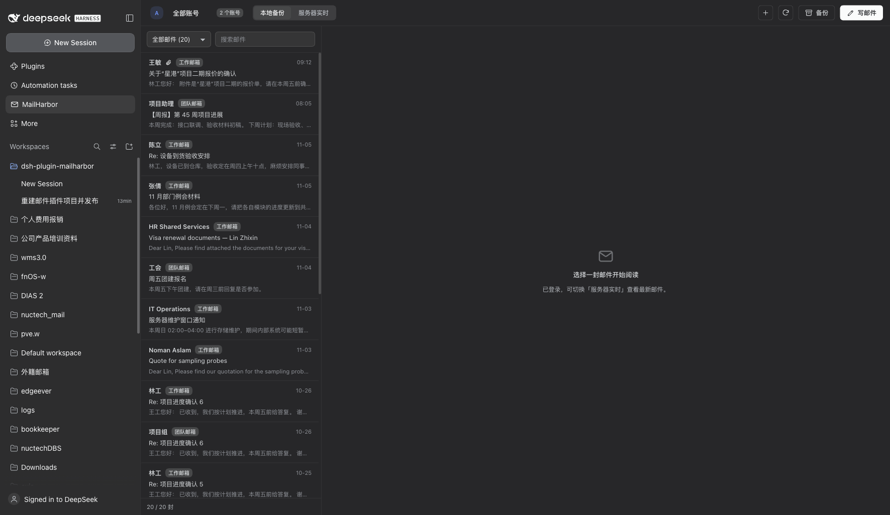
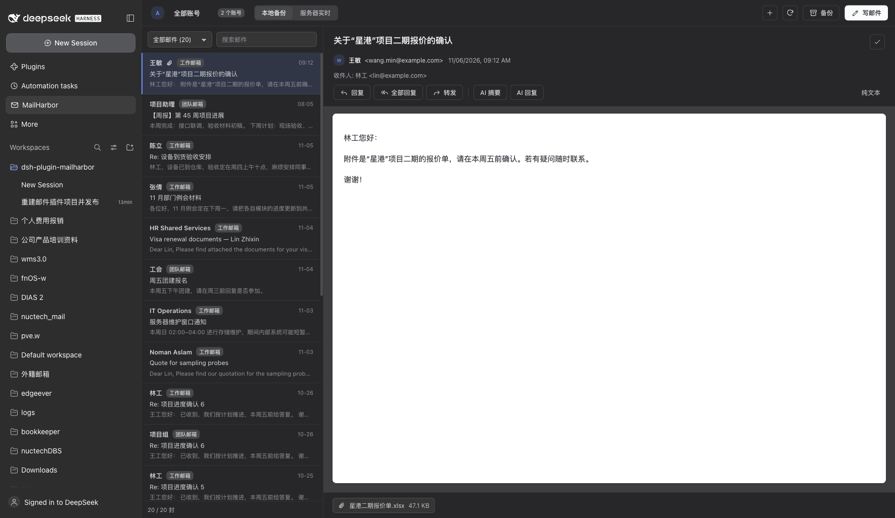
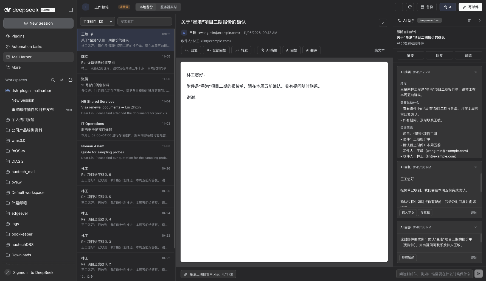
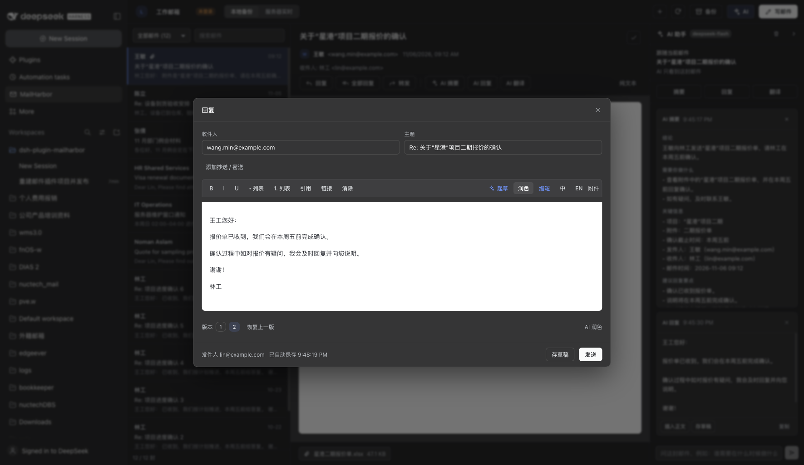
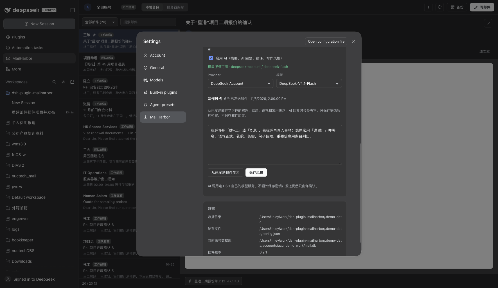

# MailHarbor（邮件港）

[](https://github.com/Zac-Linley/dsh-plugin-mailharbor/actions/workflows/ci.yml)
[](https://www.npmjs.com/package/@zaclinley/dsh-mailharbor)
[](LICENSE)
[](https://github.com/Zac-Linley/dsh-plugin-mailharbor)

**把多个 IMAP/SMTP 邮箱接进 [DeepSeek Harness](https://github.com/Zac-Linley/dsh-plugin-mailharbor) 的邮件工作区。**

MailHarbor 在 DSH 左侧栏加一个「邮件」入口，主面板里是完整的收发邮件工作区：浏览本地备份或
服务器实时邮件、搜索、安全地渲染 HTML 正文、写邮件与回复、保存草稿，也可以让模型通过
`mail_*` 工具直接读信。每个账号有独立的数据目录、草稿和已读状态。

- 包名：`@zaclinley/dsh-mailharbor`
- 要求：**DSH `>=0.2.2-0 <0.3.0`**，Node **>=24.9**（DSH 自带运行时即可）
- 许可证：MIT
- 状态：**v0.17.0 — 本地优先 + 后台同步 + AI 搜索 + 项目 + 看板任务 + 响应式布局**。

## 功能

| 区域       | 能做什么                                                                                                                                                                                                           |
| ---------- | ------------------------------------------------------------------------------------------------------------------------------------------------------------------------------------------------------------------ |
| 账号       | 任意 IMAP/SMTP 邮箱，密码或应用专用密码；每账号独立数据目录；账号与文件夹在左侧栏                                                                                                                                  |
| 本地优先   | 打开即从本地 SQLite 备份显示，随后后台增量同步；同步按钮带进度与启停                                                                                                                                               |
| 浏览       | 可折叠账号/文件夹栏、分页、按主题从整个备份组会话、AI 搜索                                                                                                                                                         |
| 操作       | 标星、归档、删除到垃圾箱、移动到任意文件夹；多选批量已读/未读/标星/归档/删除                                                                                                                                       |
| 阅读       | sandbox + 严格 CSP；内嵌 cid 图片转 data URL；远程图片拦截；附件多时折叠                                                                                                                                           |
| 写邮件     | 富文本、附件、回复/全部回复/转发（In-Reply-To/References）、联系人补全、按账号签名、二次确认                                                                                                                       |
| 草稿       | 本地草稿在手动保存/关闭时镜像到 IMAP Drafts 并替换旧副本，丢弃/发送时清理                                                                                                                                          |
| AI         | 单封邮件工作台：摘要（简洁/标准/详细）、回复、翻译、问答、写作风格；内联展开；AI 搜索；写信润色                                                                                                                    |
| 项目       | 生成项目文件夹（BRIEF.md、CONVERSATION.md）并注册到 DSH Workspaces；追加 AI 记录、加入邮件、Finder 打开；删除时可连同文件夹/工作空间；带日期记录时间线（可转任务）、四种手动状态、任务计数；附件可复制进项目文件夹 |
| 任务       | 四列看板（待处理/进行中/已完成/终止），截止/优先级/负责人/项目、来源邮件、AI 提取                                                                                                                                  |
| 凭据       | macOS 钥匙串、libsecret、Windows Credential Locker；密钥不写入 config.json                                                                                                                                         |
| 迁移       | 导出/导入 JSON：账号（不含密钥）、签名与阅读设置                                                                                                                                                                   |
| Agent 工具 | `mail_status`、`mail_list`、`mail_read`、`mail_search`、`mail_drafts`、`mail_draft`、`mail_backup`                                                                                                                 |
| 设置       | DSH 设置 → MailHarbor：账号、服务器、连接检查、签名、阅读、列表数量、AI 模型与写作风格、项目根目录、会话索引重建                                                                                                   |
| 布局       | 响应式：文件夹栏变抽屉，列表/阅读单栏切换，AI 助手变浮层，阅读操作收进「更多」                                                                                                                                     |

## 界面

| 统一收件箱                                                                                                        | 阅读页                                                                                                         |
| ----------------------------------------------------------------------------------------------------------------- | -------------------------------------------------------------------------------------------------------------- |
|  |  |

| AI 工作台（每封邮件独立、持久保存）                                                                                     | 写信页 AI 与版本栈                                                                                                  |
| ----------------------------------------------------------------------------------------------------------------------- | ------------------------------------------------------------------------------------------------------------------- |
|  |  |



> 截图使用 `node scripts/seed-demo.mjs` 生成的虚构演示数据，不含真实邮件。

## 安装

```bash
dsh plugin --profile desktop add @zaclinley/dsh-mailharbor
```

安装后重新加载窗口（或重启 DSH），浏览器端插件包才会加载。包内的 `cordis.patch.yml`
会自动插入 `mailharbor` 这一行。

从本地仓库安装：

```bash
git clone https://github.com/Zac-Linley/dsh-plugin-mailharbor.git
cd dsh-plugin-mailharbor
npm ci && npm run build
dsh plugin --profile desktop add link:$PWD
```

> 如果之前装过旧的 `dsh-plugin-mail`，请先移除那一行：两个插件都占用 `/mail-plugin`
> 的 HTTP 前缀，只能有一个生效。

## 第一次使用

1. 从左侧栏打开 **MailHarbor**。
2. 添加账号：邮箱地址 + 密码（或应用专用密码）。「高级设置」里可改 IMAP/SMTP 主机、端口和 TLS；
   保存前会真实连接一次 IMAP 校验。
3. 打开即显示本地备份，顶部同步按钮在后台拉取新邮件。
4. 点「写邮件」开始写信；新邮件会在下次同步后出现。

### Gmail、Outlook 与其他服务商

- Gmail：启用 IMAP，并使用**应用专用密码**（需先开启两步验证）。
- Microsoft 365：应用专用密码只在租户仍允许 IMAP AUTH 时可用。
- Yahoo：应用专用密码。自建邮箱：任何支持 STARTTLS 或隐式 TLS 的 IMAP/SMTP 都可以。

## 从 `dsh-plugin-mail` 迁移

包名改了，数据根目录也从 `~/.dsh/mail-plugin` 换到了 `~/.dsh/mailharbor`。安装包里附带迁移脚本：

```bash
# 只预览，不写入
node node_modules/@zaclinley/dsh-mailharbor/scripts/migrate-legacy.mjs --dry-run

# 默认：新账号直接指向旧备份目录（不复制，秒级完成，8 GB 数据库原地保留）
node node_modules/@zaclinley/dsh-mailharbor/scripts/migrate-legacy.mjs

# 或者复制一份到新数据目录（占用双倍磁盘）
node node_modules/@zaclinley/dsh-mailharbor/scripts/migrate-legacy.mjs --copy
```

脚本按邮箱匹配账号，改写 `dataDir`，把已读状态和草稿转换成新结构，并把 macOS 钥匙串密码复制到
新的 service 名下。迁移完重启 DSH，Host 才会重新打开数据库。

## 数据与隐私

| 内容             | 位置                                                                  |
| ---------------- | --------------------------------------------------------------------- |
| 插件状态         | `~/.dsh/mailharbor`（`DSH_MAILHARBOR_DATA_DIR`）                      |
| 配置（不含密码） | `~/.dsh/mailharbor/config.json`（`DSH_MAILHARBOR_CONFIG`）            |
| 每账号备份库     | `~/.dsh/mailharbor/accounts/<id>/mail.db` + `attachments/`            |
| 草稿 / 已读      | `<account>/drafts.json`、`<account>/read-state.json`                  |
| 密码             | 只进系统凭据库；脚本化场景可用 `DSH_MAILHARBOR_PASSWORD_<ACCOUNT_ID>` |

- 面板和工具以**只读**方式打开备份库，只有备份引擎会写入。
- HTML 邮件在 `sandbox` iframe 中渲染，CSP 为 `default-src 'none'`；脚本、表单不执行，远程图片默认不加载。
- HTTP 接口只监听 DSH 自己的回环端口，跨站写请求返回 `403`。
- `mail_*` 工具不能发信：没有 `mail_send`，发送必须由用户在面板里确认。
- AI 通过 DSH 自己的 `ctx.llm` 调用，关闭后不会发送任何内容；写作风格只保存提炼后的档案，不保存邮件原文。
- AI 卡片按账号保存在 `ai-threads.json`（最多 50 个线程、每线程 50 张卡片，可一键清除）。

## Agent 工具

| 工具                         | 用途                                         |
| ---------------------------- | -------------------------------------------- |
| `mail_status`                | 账号、登录状态、本地邮件数、上次备份         |
| `mail_list`                  | 列出本地或服务器邮件（文件夹、关键词、条数） |
| `mail_read`                  | 读一封邮件全文，带附件元数据                 |
| `mail_search`                | 本地备份全文搜索                             |
| `mail_drafts` / `mail_draft` | 列出、新建或更新本地草稿——永不发送           |
| `mail_backup`                | 后台启动一次增量备份                         |

## 开发

```bash
npm ci
npm run build        # lib/index.js（Host）+ lib/client.js（浏览器包）
npm run dev          # 监听改动，DSH 自动热重载
npm run typecheck
npm run lint
npm test             # Vitest：单元 + HTTP 集成 + 构建产物契约
npm run check        # typecheck + lint + build + test + pack 检查
```

目录结构：

```
src/host/       Node 端：配置、凭据、IMAP、SMTP、SQLite、备份、HTTP API、工具
src/client/     浏览器端：面板、阅读页、写信、设置、样式
src/shared/     两端共享的协议类型
scripts/        build.mjs（esbuild）、sync-version.mjs
test/           Vitest 测试（fixture 自动生成，不需要真实邮箱）
```

浏览器包由 esbuild 构建成 DSH 的模块加载格式
（`window.__ModuleLoader__.load({ id, factory })`），`id` 必须等于包名。React / React DOM
来自宿主共享模块表，不打进包里。

### 发布

版本用 [Changesets](https://github.com/changesets/changesets) 管理：

```bash
npx changeset          # 描述改动并选择 bump 级别
npm run version        # 写 CHANGELOG.md，更新 package.json 与 VERSION 常量
```

CI 会在 `main` 上通过 `.github/workflows/release.yml` 发布；仓库需要配置有 `@zaclinley/*`
发布权限的 `NPM_TOKEN` secret。详见 [CONTRIBUTING.md](CONTRIBUTING.md)。

## 路线图

| 版本      | 范围                                                      |
| --------- | --------------------------------------------------------- |
| **0.1.x** | 核心邮件工作区、备份、工具、设置、发布流水线              |
| 0.2       | 界面重做、从 `dsh-plugin-mail` 迁移数据、安装体验         |
| 0.3       | 草稿、统一收件箱、服务器分页、AI 摘要/回复/翻译、写作风格 |
| 0.4       | 常驻 AI 工作台、写信版本栈                                |
| 0.5       | 从邮件建项目、任务面板                                    |
| 0.6       | 账号/文件夹侧栏、看板任务、服务器浏览提速                 |
| 0.7       | AI 搜索、会话分组、目录选择器、四列任务看板               |
| 0.8–0.16  | 本地优先、邮件操作、草稿镜像、响应式布局、配置迁移        |
| Later     | 暂不做 OAuth2（应用专用密码已覆盖 IMAP/SMTP）             |
| 以后      | 报告、导出/导入、引导流程、更完整的附件支持               |

## 许可证

[MIT](LICENSE) © 2026 Zac Linley
